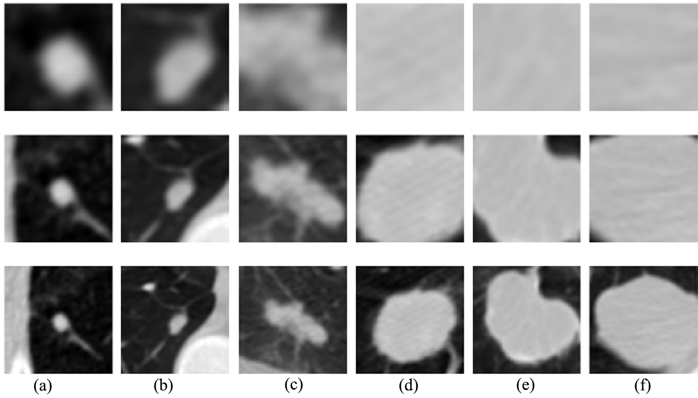
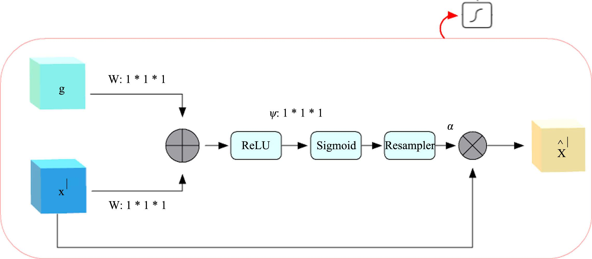

# MP-AFNet for Lung Nodule False-Positive Reduction

[Paper](https://doi.org/10.4236/jcc.2021.94001) · [LUNA16](https://luna16.grand-challenge.org/Data/) · [Citation](CITATION.cff)

I am **Vamsi Krishna Vipparla**. This repository contains the PyTorch implementation of MP-AFNet, the multi-patch attention and hybrid fusion method described in *Attention Based Multi-Patched 3D-CNNs with Hybrid Fusion Architecture for Reducing False Positives during Lung Nodule Detection* (2021).

MP-AFNet scores candidate locations supplied with volumetric chest CT scans. It combines three 3D CNN families to distinguish lung nodules from candidates with similar appearance, such as vessel crossings.



**Figure 8.** Candidate context at three patch sizes, from Vipparla et al. (2021). [Paper](https://doi.org/10.4236/jcc.2021.94001) · [CC BY 4.0](https://creativecommons.org/licenses/by/4.0/)

## Method

1. **CT preprocessing.** Resample to 1 mm isotropic spacing with nearest-neighbor interpolation. Smooth at `σ = 1 mm` and isolate the lung fields using iterative intensity thresholding, 3D erosion, connected components, and bounded mask expansion. Convert candidate coordinates from physical millimeters to voxel indices. Clip each crop to `[-1000, 400]` HU and scale to `[0, 1]`.
2. **Multi-patch attention.** Extract `16³`, `32³`, and `48³` patches around each candidate. Each model processes the scales in separate branches and concatenates their features before classification. The gate combines stage features with pooled context to produce a voxel-wise weight.
3. **Balanced training.** Augment positive candidates using right-angle rotations, flips, and one-voxel shifts shared across patch scales. Draw an equal number of samples from a rotating, shuffled negative pool at each iteration.
4. **Hybrid fusion.** Each model votes nodule when its score exceeds 0.5. Average the nodule scores of models that agree with the majority. For scores of 0.482, 0.997, and 0.993, the fused score is 0.995.

| Model | CLI family | Backbone |
|---|---|---|
| MP-ACNN1 | `custom` | Four convolution stages and a 512-unit classification head |
| MP-ACNN2 | `residual` | 16 bottleneck blocks per scale and global max pooling |
| MP-ACNN3 | `dense` | Three five-layer dense blocks per scale and global average pooling |
| MP-AFNet | `fuse` | Hybrid fusion of the three MP-ACNN outputs |



**Figure 10.** Additive attention gate, from Vipparla et al. (2021), converted to PNG. [Paper](https://doi.org/10.4236/jcc.2021.94001) · [CC BY 4.0](https://creativecommons.org/licenses/by/4.0/)

## Published LUNA16 results

The values below are from Table 4 of the paper. CPM averages FROC sensitivity at **0.125, 0.25, 0.5, 1, 2, 4, and 8 false positives per scan**. The evaluation command writes the CPM measured for your run to `metrics.json`. [Published results](https://doi.org/10.4236/jcc.2021.94001)

| Method | Published CPM |
|---|---:|
| MP-ACNN1 | 0.900 |
| MP-ACNN2 | 0.886 |
| MP-ACNN3 | 0.878 |
| **MP-AFNet** | **0.931** |

## Installation

Use Python 3.12. The examples use CUDA for training and inference. Install the appropriate PyTorch build for your system. [PyTorch installation](https://pytorch.org/get-started/locally/)

```bash
python3 -m venv .venv
source .venv/bin/activate
python -m pip install -e '.[evaluation,test]'
mp-afnet --help
python -m pytest -q
```

## Data preparation

Download LUNA16 subsets 0–9, `candidates_V2.zip`, `annotations.csv`, and `evaluationScript.zip`. Preserve the ten subset directories and keep each scan's `.mhd` and `.raw` files together. Extract the evaluator with its helper modules and `annotations_excluded.csv`. [LUNA16 data guide](https://luna16.grand-challenge.org/Data/) · [Challenge downloads](https://zenodo.org/records/3723295)

```text
data/
├── raw/
│   ├── subset0/
│   ├── ...
│   └── subset9/
├── candidates_V2.csv
├── annotations.csv
└── evaluationScript/
    ├── noduleCADEvaluationLUNA16.py
    └── annotations/
        └── annotations_excluded.csv
```

```bash
mp-afnet prepare --raw data/raw --candidates data/candidates_V2.csv --output data/prepared
```

Preparation writes one memory-mapped CT array per scan, candidate and scan manifests, and preprocessing settings. Use `--preprocessing resample` with a separate output directory to run the resampling-only ablation. Candidates keep their original coordinates and subset membership.

## Training, inference, and evaluation

For each held-out LUNA16 subset, set aside 20% of the remaining scans for validation using a fixed seed. Training uses 12 balanced iterations of 3 epochs, a default batch size of 64, SGD with learning rate 0.001 and momentum 0.9, and dropout 0.5. The run saves the checkpoint with the lowest validation cross-entropy and records its scan split, parameters, seed, and metrics. Adjust `--batch-size` to fit your GPU. The CUDA example allows operations that may have nondeterministic gradients.

```bash
for fold in {0..9}; do
  for family in custom residual dense; do
    mp-afnet train --data data/prepared --test-fold "$fold" --family "$family" \
      --output "runs/fold${fold}/${family}" --device cuda --allow-nondeterministic
    mp-afnet predict --data data/prepared \
      --checkpoint "runs/fold${fold}/${family}/best.pt" \
      --output "outputs/fold${fold}-${family}.csv" --device cuda
  done
  mp-afnet fuse "outputs/fold${fold}-custom.csv" "outputs/fold${fold}-residual.csv" \
    "outputs/fold${fold}-dense.csv" --output "outputs/fold${fold}-hybrid.csv"
done

mp-afnet merge outputs/fold*-hybrid.csv --data data/prepared --output outputs/mp-afnet.csv
mp-afnet evaluate --data data/prepared --predictions outputs/mp-afnet.csv \
  --evaluator data/evaluationScript/noduleCADEvaluationLUNA16.py \
  --annotations data/annotations.csv --excluded data/evaluationScript/annotations/annotations_excluded.csv \
  --bootstraps 1000 --output outputs/evaluation
```

Fusion joins predictions by scan and physical candidate coordinates. Merge requires one prediction per candidate. Evaluation uses the full scan manifest and the LUNA16 scoring script, then writes `froc_mp_afnet.png` and `metrics.json`. For fold-level evaluation, use `--fold` with that fold's prediction file. To compare architectures, pass `--no-attention` or `--sizes 16` at training time, or `--method mean` at fusion time. Use distinct run and output directories for each comparison.

## Citation

```bibtex
@article{vipparla2021attention,
  title   = {Attention Based Multi-Patched 3D-CNNs with Hybrid Fusion Architecture for Reducing False Positives during Lung Nodule Detection},
  author  = {Vipparla, Vamsi Krishna and Chilukuri, Premith Kumar and Kande, Giri Babu},
  journal = {Journal of Computer and Communications},
  year    = {2021},
  volume  = {9},
  number  = {4},
  pages   = {1--26},
  doi     = {10.4236/jcc.2021.94001}
}
```

The implementation uses the LUNA16 benchmark and draws on prior work in lung segmentation, additive attention, residual learning, and dense connectivity. [LUNA16](https://arxiv.org/abs/1612.08012) · [Pulagam et al.](https://doi.org/10.1007/s10278-016-9875-z) · [Attention gates](https://arxiv.org/abs/1804.03999) · [ResNet](https://arxiv.org/abs/1512.03385) · [DenseNet](https://arxiv.org/abs/1608.06993)
