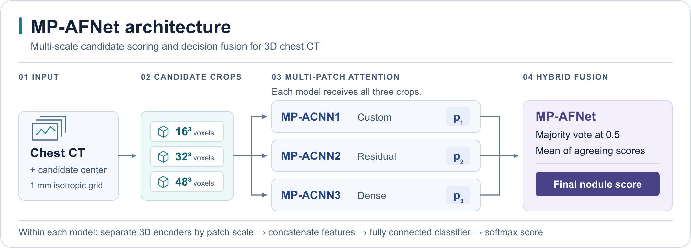
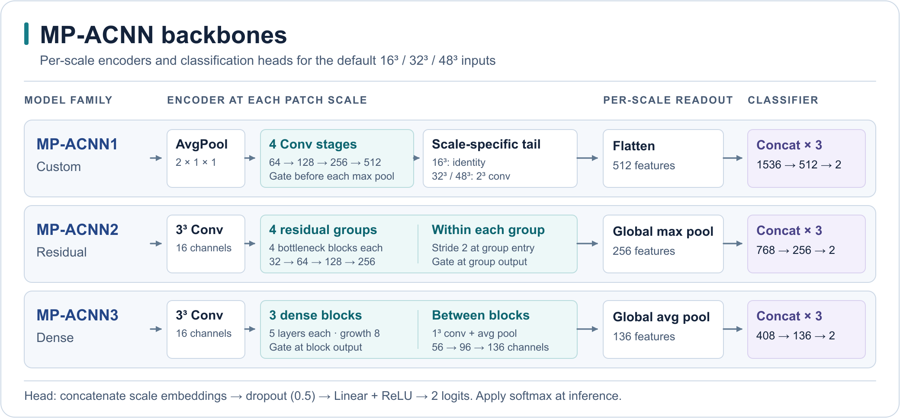
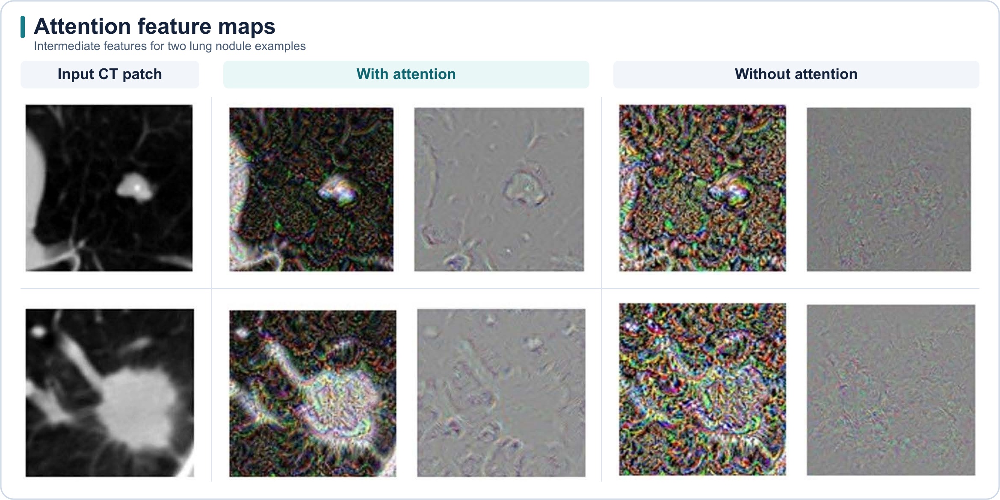

# MP-AFNet for Lung Nodule False-Positive Reduction

[Paper](https://doi.org/10.4236/jcc.2021.94001) · [LUNA16](https://luna16.grand-challenge.org/Data/) · [Reproduce the experiments](#reproduce-the-luna16-experiments) · [Citation](CITATION.cff)

I am **Vamsi Krishna Vipparla**. This repository implements MP-AFNet in PyTorch, the multi-patch attention and hybrid fusion method from my 2021 paper, *Attention Based Multi-Patched 3D-CNNs with Hybrid Fusion Architecture for Reducing False Positives during Lung Nodule Detection*.

MP-AFNet scores candidate locations supplied with volumetric chest CT scans. It combines three 3D CNN families to distinguish lung nodules from candidates with similar appearance, such as vessel crossings.



**MP-AFNet architecture.** Three attention CNNs score each candidate at multiple patch scales. Hybrid fusion combines their scores into a final nodule score. [SVG](docs/images/mp-afnet-overview.svg) · [Paper, Figure 11](https://doi.org/10.4236/jcc.2021.94001) · [CC BY 4.0](https://creativecommons.org/licenses/by/4.0/)

## Method

1. **CT preprocessing.** Resample to 1 mm isotropic spacing with nearest-neighbor interpolation. Smooth at `σ = 1 mm` and isolate the lung fields using iterative intensity thresholding, 3D erosion, connected components, and bounded mask expansion. Convert candidate coordinates from physical millimeters to voxel indices. Clip each crop to `[-1000, 400]` HU and scale to `[0, 1]`.
2. **Multi-patch attention.** Extract `16³`, `32³`, and `48³` patches around each candidate. Each model processes the scales in separate branches and concatenates their features before classification. The gate combines stage features with pooled context to produce a voxel-wise weight.
3. **Balanced training.** Augment positive candidates using right-angle rotations, flips, and one-voxel shifts shared across patch scales. Draw an equal number of samples from a rotating, shuffled negative pool at each iteration.
4. **Hybrid fusion.** Each model votes nodule when its score exceeds 0.5. Average the nodule scores of models that agree with the majority. For scores of 0.482, 0.997, and 0.993, the fused score is 0.995.

### Backbone design



**MP-ACNN backbones.** The custom, residual, and dense CNNs concatenate features from three patch scales before classification. The diagram gives the default PyTorch dimensions. Select a backbone with `--family custom`, `--family residual`, or `--family dense`. [SVG](docs/images/mp-acnn-backbones.svg) · [Model code](src/lung_attention/models.py) · [Paper, Figure 9](https://doi.org/10.4236/jcc.2021.94001) · [CC BY 4.0](https://creativecommons.org/licenses/by/4.0/)

### Patch examples and additive attention gate


**Multi-scale CT patches.** Larger crops capture more of the anatomy surrounding a candidate. [Paper, Figure 8](https://doi.org/10.4236/jcc.2021.94001) · [CC BY 4.0](https://creativecommons.org/licenses/by/4.0/)


**Additive attention gate.** The gate combines local features with coarser context to weight each spatial location. [Paper, Figure 10](https://doi.org/10.4236/jcc.2021.94001) · [CC BY 4.0](https://creativecommons.org/licenses/by/4.0/)

## Published LUNA16 results

The values below are from Table 4 of the paper. CPM averages FROC sensitivity at **0.125, 0.25, 0.5, 1, 2, 4, and 8 false positives per scan**. The evaluation command writes the CPM measured for your run to `metrics.json`. [Published results](https://doi.org/10.4236/jcc.2021.94001)

| Method | Published CPM |
|---|---:|
| MP-ACNN1 | 0.900 |
| MP-ACNN2 | 0.886 |
| MP-ACNN3 | 0.878 |
| **MP-AFNet** | **0.931** |

### Attention feature maps



**Intermediate feature maps with and without attention.** Each row shows a CT input patch and the corresponding intermediate features from both model variants. [Paper, Figure 17](https://doi.org/10.4236/jcc.2021.94001) · [CC BY 4.0](https://creativecommons.org/licenses/by/4.0/)

## Reproduce the LUNA16 experiments

### 1. Clone and install

Run these commands in Bash on Linux with Git, Python 3.12, curl, unzip, and an NVIDIA GPU. The example installs the PyTorch wheel for CUDA 12.8. For a different CUDA version, choose the corresponding wheel for your system. [PyTorch installation](https://pytorch.org/get-started/previous-versions/)

```bash
git clone https://github.com/vamsivipparla/mp-afnet.git
cd mp-afnet
python3.12 -m venv .venv
source .venv/bin/activate
python -m pip install torch==2.9.1 --index-url https://download.pytorch.org/whl/cu128
python -m pip install -e '.[evaluation,test]'
mp-afnet --help
python -c 'import torch; assert torch.cuda.is_available(), "Install a CUDA-enabled PyTorch build"; print(torch.cuda.get_device_name(0))'
```

### 2. Download and unpack LUNA16

Download all ten CT subsets and the candidate list, annotations, and evaluator for the false-positive reduction track. The CT downloads total about 66 GB. Allow additional space for the unpacked scans and the prepared 1 mm volumes. The download commands resume partial files when rerun. [LUNA16 data guide](https://luna16.grand-challenge.org/Data/) · [LUNA16 Part 1](https://zenodo.org/records/3723295) · [LUNA16 Part 2](https://zenodo.org/records/4121926)

```bash
bash <<'BASH'
set -euo pipefail
mkdir -p data/downloads data/raw

part1=https://zenodo.org/records/3723295/files
part2=https://zenodo.org/records/4121926/files

download() {
  local url="$1" dest="$2"
  if [[ ! -s "$dest" ]]; then
    curl --fail --location --retry 5 --continue-at - \
      --output "$dest.part" "$url"
    mv "$dest.part" "$dest"
  fi
}

for fold in {0..9}; do
  base="$part1"
  if (( fold >= 7 )); then base="$part2"; fi
  zip="subset${fold}.zip"
  download "$base/$zip?download=1" "data/downloads/$zip"
  mkdir -p "data/raw/subset${fold}"
  unzip -ojq "data/downloads/$zip" '*.mhd' '*.raw' -d "data/raw/subset${fold}"
done

download "$part1/candidates_V2.zip?download=1" data/downloads/candidates_V2.zip
download "$part1/annotations.csv?download=1" data/annotations.csv
download "$part1/evaluationScript.zip?download=1" data/downloads/evaluationScript.zip
unzip -oq data/downloads/candidates_V2.zip candidates_V2.csv -d data
unzip -oq data/downloads/evaluationScript.zip -d data
BASH
```

The resulting inputs are organized as follows. Keep each scan’s `.mhd` header and `.raw` volume in the same subset directory.

```text
data/
├── raw/
│   ├── subset0/
│   ├── ...
│   └── subset9/
├── candidates_V2.csv
├── annotations.csv
└── evaluationScript/
    ├── noduleCADEvaluationLUNA16.py
    ├── NoduleFinding.py
    ├── tools/
    └── annotations/
        └── annotations_excluded.csv
```

### 3. Verify the evaluator and prepare scans

```bash
LUNA16_EVALUATOR=data/evaluationScript/noduleCADEvaluationLUNA16.py python -m pytest -q
mp-afnet prepare --raw data/raw --candidates data/candidates_V2.csv \
  --preprocessing lung --output data/prepared
cat data/prepared/preprocessing.json
```

Preparation writes one memory-mapped CT array per scan, the scan and candidate manifests, and preprocessing settings. The full benchmark has 888 scans. Candidates retain their original coordinates and subset membership.

### 4. Train, predict, fuse, and evaluate all ten folds

Each LUNA16 subset serves as the held-out test fold once. The same seed selects 20% of the remaining scans for validation across the three CNN families. Training uses 12 balanced iterations of 3 epochs and selects the checkpoint with the lowest validation cross-entropy. Use a fresh experiment name for each run. Set `MP_AFNET_BATCH_SIZE` if you need a smaller batch to fit GPU memory. The CUDA commands allow operations with nondeterministic gradients.

Define this function in the Bash session where you activated the environment.

```bash
run_luna16() (
  set -euo pipefail
  experiment="$1"
  shift
  output="outputs/$experiment"
  mkdir -p "$output"

  for fold in {0..9}; do
    for family in custom residual dense; do
      run_dir="runs/$experiment/fold${fold}/$family"
      mp-afnet train --data data/prepared --test-fold "$fold" --family "$family" \
        --output "$run_dir" --iterations 12 --epochs-per-iteration 3 \
        --positive-repeats 40 --batch-size "${MP_AFNET_BATCH_SIZE:-64}" \
        --learning-rate 0.001 --seed 2021 --device cuda --allow-nondeterministic "$@"
      mp-afnet predict --data data/prepared --checkpoint "$run_dir/best.pt" \
        --output "$output/fold${fold}-$family.csv" --device cuda
    done
    mp-afnet fuse "$output/fold${fold}-custom.csv" "$output/fold${fold}-residual.csv" \
      "$output/fold${fold}-dense.csv" --method hybrid --output "$output/fold${fold}-hybrid.csv"
  done

  for method in custom residual dense hybrid; do
    mp-afnet merge "$output"/fold*-"$method".csv --data data/prepared \
      --output "$output/$method.csv"
    mp-afnet evaluate --data data/prepared --predictions "$output/$method.csv" \
      --evaluator data/evaluationScript/noduleCADEvaluationLUNA16.py \
      --annotations data/annotations.csv \
      --excluded data/evaluationScript/annotations/annotations_excluded.csv \
      --bootstraps 1000 --seed 2021 --output "$output/evaluation/$method"
  done
)
```

Run the multi-patch attention experiment.

```bash
run_luna16 attention --sizes 16 32 48
cat outputs/attention/evaluation/hybrid/metrics.json
```

Run the comparisons using the same held-out folds and seed. The single-scale examples use `32³` patches.

```bash
run_luna16 no-attention --sizes 16 32 48 --no-attention
run_luna16 single-scale-32 --sizes 32
run_luna16 single-scale-32-no-attention --sizes 32 --no-attention
```

Each model saves its scan split, settings, training history, and selected checkpoint under `runs/<experiment>/`. The merged CSVs contain one held-out prediction per candidate. Each evaluation directory contains a FROC plot (`froc_mp_afnet.png`), the CPM and operating points (`metrics.json`), and the challenge evaluator outputs.

## Citation

```bibtex
@article{vipparla2021attention,
  title   = {Attention Based Multi-Patched 3D-CNNs with Hybrid Fusion Architecture for Reducing False Positives during Lung Nodule Detection},
  author  = {Vipparla, Vamsi Krishna and Chilukuri, Premith Kumar and Kande, Giri Babu},
  journal = {Journal of Computer and Communications},
  year    = {2021},
  volume  = {9},
  number  = {4},
  pages   = {1--26},
  doi     = {10.4236/jcc.2021.94001}
}
```

The implementation uses the LUNA16 benchmark and draws on prior work in lung segmentation, additive attention, residual learning, and dense connectivity. [LUNA16](https://arxiv.org/abs/1612.08012) · [Pulagam et al.](https://doi.org/10.1007/s10278-016-9875-z) · [Attention gates](https://arxiv.org/abs/1804.03999) · [ResNet](https://arxiv.org/abs/1512.03385) · [DenseNet](https://arxiv.org/abs/1608.06993)
